# Bluebikes rebalancing and crew planning

DADS5250 — Generative AI in Practice, Group 8. This reviewable first version connects official trip data, a transparent inventory-demand proxy, an event extraction API, monthly crew planning, a reproducible submission Notebook, and an optional local Gradio app for reviewing event scenarios.

**Submission is incomplete.** TA confirmation, human-reviewed extraction labels, team contributions/review, the recorded and uploaded three-minute demo, verified grader access, and Canvas submission remain outstanding. A working analysis is not a completed submission.

Members: Satoshi Nakamura / Vinay Manikandan Nagarajan / Aditi Rao. Membership does not establish contribution; see the [review checklist](docs/REVIEW_CHECKLIST.md).



Python builds forecasts and crew plans; OpenAI extracts structured event facts through a versioned prompt and API call. Human confirmation and an explicit demand assumption gate their use in planning. The 2026 held-out trips feed evaluation only. The [editable Mermaid source](docs/diagrams/bluebikes_flow.mmd), [cached PNG](docs/diagrams/bluebikes_flow.png) and [architecture notes](docs/architecture.md) describe the same flow used in the app and both Notebooks.

## Review and authorization status

- Repository: [BitCoinJr/dads5250-bluebikes-planner](https://github.com/BitCoinJr/dads5250-bluebikes-planner). GitHub visibility was checked as **private** before pushing. Keep it private.
- As of 26 October 2026, TA confirmation has **not** been received. The user reports that the TA prohibited building before confirmation; implementation proceeded at the user's explicit direction because of the deadline. This project is **not TA-approved**.
- User-supplied deadline: **28 October 2026, 23:59 ET = 29 October 2026, 12:59 JST**. The user reports that Canvas's 25 October display is outdated; no live Canvas deadline verification is claimed.
- No TA/member messages, invitations, video upload, or Canvas submission are automatically performed. The full record is in [DECISIONS.md](docs/DECISIONS.md).

## Run from the repository root

Python **3.13.2** is the implementation environment. Exact package versions are pinned in [requirements.txt](requirements.txt). The cached monthly aggregates and recorded real OpenAI outputs make the analysis and Notebook runnable without downloading raw trip files, supplying an API key, or repeating API calls. Their default event mode is `recorded`; fixture mode remains an explicit offline contract test.

Canonical working directory: `C:\dev\university\dads5250-bluebikes-planner`. The local ignored credential file is `C:\dev\university\dads5250-bluebikes-planner\.env`. Keep its `OPENAI_API_KEY` value local; the completed API run is preserved without credentials. Do not use the retired world-group task directory.

In PowerShell:

```powershell
Set-Location 'C:\dev\university\dads5250-bluebikes-planner'
py -m venv .venv --system-site-packages
.\.venv\Scripts\python.exe -m pip install -r requirements.txt
.\.venv\Scripts\python.exe -m unittest discover -s tests -v
.\.venv\Scripts\python.exe scripts/run_analysis.py
.\.venv\Scripts\python.exe scripts/build_notebook.py --execute
.\.venv\Scripts\python.exe scripts/build_demo_notebook.py --execute
```

For a clean environment, create the venv with `py -m venv .venv` instead; omit `--system-site-packages`. The option above reuses already installed packages in the implementation environment. Do not recreate an existing environment that contains unrelated work. On macOS/Linux, use `python3` and `.venv/bin/python` for the equivalent commands.

Open [notebooks/bluebikes_submission.ipynb](notebooks/bluebikes_submission.ipynb) after execution. Also inspect the compact [demo Notebook](notebooks/bluebikes_demo.ipynb) before recording; its link alone is not execution evidence. Inspect the cell outputs and the generated artifacts below. Execution must finish without cell errors; evidence is recorded rather than inferred from the commands printed here.

The current geographic revision passed **102 tests**, **17/17 submission** and **9/9 demo** code cells with outputs and zero errors, **13/13 local HTTP checks**, and a **3-cell real-kernel app launch/stop** check. Browser checks passed at **1366×900** and **390×844**. All temporary review servers were stopped and ports released; older reviews on 7860 and 7872 were left untouched. These checks made **zero new real API calls**; API-error paths use mocks. See the [final geographic verification](docs/verification-geography.json), [HTTP evidence](docs/verification-geography-http.json), and [Notebook launch evidence](docs/verification-geography-notebook.json). Optional app cells remain off by default.

Preservation checks found **100 pre-existing data, prompt, fixture and result files byte-identical** to `22d4e3d`, with **nine model modules unchanged**. The planning service's AST is unchanged after excluding the new display payload; dependencies, earlier verification reports and the shared Mermaid/SVG/PNG assets are unchanged. The prior UI-polish revision is preserved at commit `22d4e3d` and branch `preserve/ui-polish-22d4e3d`. Its **93 tests**, **16/16** submission and **8/8** demo cells, and **10/10** HTTP checks remain [historical evidence](docs/verification-ui-polish.json).

Historical evidence is preserved separately: the pre-app revision passed **64 tests**, **14/14** submission and **6/6** demo code cells with zero errors, and seven original-artifact hash checks ([baseline verification](docs/verification-demo-revision.json)). The pre-polish Gradio revision passed **85 tests**, **15/15** submission and **7/7** demo code cells, **9/9** local HTTP workflow checks and a separate real-kernel launch/stop check ([Gradio verification](docs/verification-gradio.json)). These earlier counts do not establish the latest revision's final rerun status.

Optional full acquisition and aggregation, with network access and enough local space for monthly raw archives and Parquet caches:

```powershell
.\.venv\Scripts\python.exe scripts/acquire_data.py --pilot-only
.\.venv\Scripts\python.exe scripts/acquire_data.py --workers 4
```

The first command exercises January 2024 Boston and Cambridge. The second expands to the requested periods and all station-list municipalities. Downloads and station-hour caches stay local. Check the bucket manifest for file sizes before rebuilding; raw archives are not committed. A rerun uses existing caches, so use a separate checkout/cache location when intentionally refreshing the station snapshot or changing ingestion logic.

The completed live extraction artifact is already included; the default commands above replay it without a key. For a new session-only extraction through the optional app's **実APIで抽出** button, configure `OPENAI_API_KEY` in the local process environment or the Git-ignored project `.env`; [.env.example](.env.example) shows the format without a secret. Optionally set `OPENAI_MODEL`. Existing Windows user-level environment settings are also read when this process predates the change. This command checks only safe presence/source metadata:

```powershell
.\.venv\Scripts\python.exe -m bluebikes.events --check-config
```

Use the app button for a new response in session memory. The legacy `bluebikes.events --mode live` path internally writes the canonical `results/event_extraction_live.json` before processing a CLI `--output` destination, so a different output filename alone does not preserve the original. Do not rerun that live CLI in this evidence checkout. CLI experiments need an independent copy/versioned run that cannot overwrite the frozen original artifacts. Recorded analysis continues using the preserved four-call artifact.

Never place credentials in the Notebook or tracked files. OpenAI is the sole runtime provider, selected at the user's direction. The default model is `gpt-4.1-mini`, with Responses API Structured Outputs checked against official OpenAI documentation on 26 October 2026. No SDK is needed: the adapter uses `requests`, a strict remote JSON schema, and the stronger local validator. Without a key, the live path explicitly reports a blocked state; it does not substitute fixtures. The preserved historical live artifact contains credential-free provenance; a new app extraction remains in session memory. Recorded mode validates its current prompt/source/schema request hashes and output hashes, then reuses the real recorded outputs without additional calls or a key. Fixture mode remains separately labelled and does not report its expected answers as model accuracy. See [event evidence and prompts](docs/event_sources.md).

## Optional local Gradio app

Update the environment from the current requirements before launching the app:

```powershell
.\.venv\Scripts\python.exe -m pip install -r requirements.txt
.\.venv\Scripts\python.exe scripts/run_app.py --port 7876
```

Open [http://127.0.0.1:7876](http://127.0.0.1:7876) on the same computer for this revision's review. The app's default port remains **7860**; the explicit **7876** review port avoids older reviews on 7860 and 7872. The app binds to **127.0.0.1**, sets `share=False`, and disables analytics. It does not create a public link. Stop the standalone process with **Ctrl+C**. If 7876 is occupied, choose another free local port and use the same port in the URL.

Both Notebooks include the same optional launcher, with **`LAUNCH_LOCAL_APP = False`** by default. A normal execution starts no server and makes no new model call. To interact, set the flag to `True`; its launcher is equivalent to:

```python
from bluebikes.app import launch_local
app = launch_local(ROOT, port=7860, inline=True, prevent_thread_lock=True)
# When finished, run this in a new cell:
app.close()
```

The optional cell keeps its default `LOCAL_APP_PORT = 7860`; set it to **7876** for the current visual review, or another free port for a collision. The CLI and Notebook launch the same application through [app.py](bluebikes/app.py). Restore `LAUNCH_LOCAL_APP = False` before saving/executing a submission; rerunning the disabled cell also closes a prior Notebook app handle.

The initial view uses saved real inputs, model outputs and computed results. Source text and its URL sit alongside extracted fact cards for dates, city, venue and crowd size or unknown; the structured JSON and ambiguity notes remain available for review. The architecture view reads the same cached local Mermaid image as this README and both Notebooks. **Load saved real response** replays matching preserved evidence. Only **実APIで抽出 / Extract with OpenAI** requests a new model response, using a locally configured key; opening the app does not. Explain manual corrections in review notes, then click **Confirm reviewed values (this session only)** before **計画に反映 / Apply to plan**. Confirmation and scenario application are separate actions.

Review edits remain in the session and do not overwrite the frozen raw API outputs, reference labels or evaluation CSVs. Changing source text/URL, reviewed event fields or assumptions invalidates the applied scenario and requires another apply, so an earlier result is not presented as a result of new inputs. Source changes require matching saved replay or a new extraction followed by review again.

After explicit application, KPI cards and plots update from the computed scenario. Separate tabs compare **January–December planning** and **January–September backtest** results, keeping crew cash cost and shortage on the same horizon. Hiring-decision tables distinguish a decision from next-month active staffing. The app keeps **120 course bikes/shift** fixed during counting-unit conversion and labels the **+3,000 handling-action** event increment as an uncalibrated retrospective assumption; mandatory 2027 seasonal obligations remain separate. Keep the original four-call **19/20 (95%)** agreement and separate three-call **11/15** challenge, including its participant/crowd and unsupported-date failures, visible. Human review remains pending; interacting with the app does not establish human gold labels or complete the video/submission.

The **offline geographic comparison** adds a same-month, shared-scale coordinate view of the already computed plans. It reuses all **613 station coordinates** from the existing snapshot. Whole full-time/seasonal crew bubbles appear at station-coordinate centroids for the **four core cities**; the other **nine municipalities' shared pool** is reported separately as one integer headcount per plan. Do not interpret capacity shares as fractional crews or dedicated staffing in those nine cities. Centroids are not depots, routes or event locations. The all-city view retains the model's city/group forecast-proxy handling-action units; it does not downscale demand to stations. There are no event markers, map tiles, new dependencies, downloads or model/API calls. See [geographic interpretation and limitations](docs/geographic_comparison.md), the [geographic capture](docs/screenshots/geography/desktop-april.jpg), and [current verification](docs/verification-geography.json).

The geographic revision was checked at **1366×900 desktop** and **390×844 narrow** sizes. April showed Boston full-time crews **12 → 13**, forecast-proxy actions **36,721 → 39,721**, and the separate shared pool's **2 full-time crews**. Switching the geographic month to September changed only that view; the event-decision KPI correctly remained April. Changing the increment cleared all three plots and the KPI. See the [geographic capture](docs/screenshots/geography/desktop-april.jpg) and [verification](docs/verification-geography.json). Wide charts and tables scroll inside their own containers. Earlier captures remain historical: [desktop flow](docs/screenshots/ui-polish/desktop-flow.jpg), [source/extraction](docs/screenshots/ui-polish/desktop-extraction.jpg), [decisions](docs/screenshots/ui-polish/desktop-decisions.jpg), [capacity](docs/screenshots/ui-polish/desktop-capacity.jpg), [narrow decisions](docs/screenshots/ui-polish/narrow-decisions.jpg) and [narrow table](docs/screenshots/ui-polish/narrow-table.jpg). Screenshots demonstrate presentation, not model accuracy or completed submission.

Reproduce local endpoint checks with `python scripts/verify_app_http.py` and the real-kernel launch/stop check with `python scripts/verify_app_notebook.py --port 7878 --output docs/verification-geography-notebook.json`; both make zero real API calls and close their temporary server. The completed kernel check received HTTP 200, called `app.close()` and verified port release. See [geographic verification](docs/verification-geography.json) for the current recorded status. The earlier [UI polish verification](docs/verification-ui-polish.json), [source/extraction](docs/screenshots/gradio_source_and_extraction.png) and [plan-comparison](docs/screenshots/gradio_plan_comparison.png) captures, and [Gradio verification](docs/verification-gradio.json) remain historical evidence. [Architecture](docs/architecture.md) and the [review checklist](docs/REVIEW_CHECKLIST.md) describe this optional flow.

### Regenerate the architecture image

Edit only [docs/diagrams/bluebikes_flow.mmd](docs/diagrams/bluebikes_flow.mmd), then regenerate its SVG and PNG with `node scripts/render_architecture.mjs`. The [architecture notes](docs/architecture.md#regenerate-the-shared-diagram) provide the pinned local Mermaid CLI 12.0.0 installation command. Its Node/browser tooling lives in ignored `build/`; normal Python/app/Notebook use reads the committed images without Node or a CDN. Do not hand-edit a second diagram in Markdown or the generated image files. Prior diagram checks remain in [verification-ui-polish.json](docs/verification-ui-polish.json); current geographic-revision checks belong in [verification-geography.json](docs/verification-geography.json).

## Artifacts and results

The real-data pipeline processed 33 requested months across 13 municipalities (429 city-months): 12,893,134 retained trips from 12,893,499 rows, after 143 invalid timestamp/duration rows and 222 cross-archive duplicates were excluded. File availability does not remove the internal partition gap or September censoring described below. The capped-growth forecast has January-September 2026 WAPE 9.68% (January-August 10.29%).

Cost and service below use the **same period**. Annual shortfall uses the frozen forecast; January-September shortfall uses the actual-derived proxy under fixed staffing. Neither is observed customer loss.

| Period and service basis | Plan | Same-period crew cash cost | Uncovered handling-action proxy |
|---|---|---:|---:|
| Jan-Dec 2026 forecast | Initial crews | $1,008,000 | 365,295.14 |
| Jan-Dec 2026 forecast | Frozen proposal | $1,837,200 | 10,006.65 |
| Jan-Sep 2026 observed-trip proxy | Initial crews | $756,000 | 326,680.86 |
| Jan-Sep 2026 observed-trip proxy | Frozen proposal | $1,342,800 | 48,126.86 |

Mandatory 2027 seasonal obligations are separate from 2026 crew cash cost in [scenario_period_comparison.csv](results/scenario_period_comparison.csv); they are $0 for these current base cases. Do not compare annual proposal cost with only nine months of service. See [summary.json](results/summary.json) and the [crew plan](results/plan_2026.csv).

**Focused event demo.** The recorded real LLM output extracts 20 April 2026 and Boston as the named Marathon route endpoint. Adding an assumed **3,000 handling actions** changes the April Boston forecast **36,721.19 to 39,721.19**, full-time crews **12 to 13**, and April crew cash cost **$72,000 to $78,000**; seasonal crews remain zero. This is an **uncalibrated retrospective** wiring scenario, not demonstrated forecast improvement. Hiring/contracts may change other months too. The [input ledger](results/event_city_month_inputs.csv), [focused chain](results/focused_event_chain.csv), and [full-calendar chain](results/calendar_event_chain.csv) preserve the source URL, exclusions and resulting changes. Supplemental audience cases are evaluation-only and add no event increments.

**Unit interpretation and replanning.** The course stays at **120 bikes/shift**. Factor one maps one handling action to one course-bike unit. Factor two maps pickup plus delivery (two handling actions) to one course-bike unit: divide demand before replanning and convert uncovered units back to handling actions afterward. January capacity remains **3,188.57 course-bike units per crew** in both cases, and the assumed penalty per uncovered handling action stays fixed.

| Period / service basis | Actions per course bike | Peak FT / seasonal / total crews | Same-period crew cash cost | Uncovered handling actions |
|---|---:|---:|---:|---:|
| Jan-Dec / forecast | 1 | 24 / 8 / 32 | $1,837,200 | 10,006.65 |
| Jan-Dec / forecast | 2 | 14 / 5 / 18 | $1,103,700 | 1,853.08 |
| Jan-Sep / observed proxy | 1 | 24 / 8 / 32 | $1,342,800 | 48,126.86 |
| Jan-Sep / observed proxy | 2 | 14 / 5 / 18 | $830,700 | 30,640.14 |

These are conditional accounting interpretations, not measured van productivity. Peak total uses the same-month FT + seasonal sum; the separate FT/seasonal peaks can occur in different months. [unit_interpretation_comparison.csv](results/unit_interpretation_comparison.csv) also includes matched-period initial-crew baselines. The factor-two plan is **newly optimized on the converted forecast**. The older frozen-crew capacity sensitivity changes service only and cannot show a new staffing/cost recommendation. For example, keeping the existing proposal crews under factor two retains January-September cost **$1,342,800** and leaves **0** proxy actions uncovered; replanning instead gives **$830,700 / 30,640.14**. These are different experiments. Factor two assumes handling endpoints can be paired; unbalanced city/depot flows cannot automatically be halved. See the [synthetic hand count](docs/handling_unit_walkthrough.md). See [scenario assumptions](docs/scenario_assumptions.md).

A genuine OpenAI run completed on **27 October 2026 JST**: **four API calls**, all four outputs accepted by local schema/provenance validation, using the returned model **`gpt-4.1-mini-2025-04-14`**. The result has **19/20 (95%) exact field agreement with provisional agent-authored labels**, not measured accuracy against human-reviewed gold. The Cambridge location includes the source-supported city/state/ZIP beyond the shorter reference address; it is the sole exact-match disagreement across the five scored fields. An **unscored semantic caveat** remains: the Head Of The Charles ambiguity says the event is known to span multiple locations, beyond the supplied short excerpt. This requires human review and is outside the 19/20 score; the raw output is unchanged. See [live extraction evidence](results/event_extraction_live.json) and the [extraction review](docs/event_extraction_review.md).

A **separate three-call evaluation** produced **11/15 (73.3%) exact agreement** with frozen supplemental AI draft references. The two positive crowd values matched (2/2), but both texts concern the **same HOCR event** and are correlated. Their source qualifiers, **more than 300,000** and **approximately 325,000**, are not exact measured attendance; the model omitted the qualifiers from its ambiguity prose. In the participant-only case it wrongly used **30,000 participants as crowd** and supplied **21 April 2026** despite absent event dates. Expanded location wording was the fourth exact-match disagreement. Preserve this score separately from the original four-call 19/20 result. Supplemental cases are **evaluation-only**: no forecast, prompt or staffing adjustment uses them. Human review remains **PENDING**. See [supplemental evaluation](results/event_extraction_additional_evaluation.json) and [review rows](results/event_extraction_additional_review.csv).


| Artifact | Purpose |
|---|---|
| [Submission Notebook](notebooks/bluebikes_submission.ipynb) | Full narrative, executable entry point and outputs |
| [Demo Notebook](notebooks/bluebikes_demo.ipynb) | Compact real-event-to-plan walkthrough; verify its execution |
| [Local app](bluebikes/app.py) / [CLI launcher](scripts/run_app.py) | Optional localhost review, explicit apply and conditional replanning; live extraction only by button |
| [Matched-period comparisons](results/scenario_period_comparison.csv) | Annual forecast and nine-month observed-proxy comparisons |
| [Unit replanning comparison](results/unit_interpretation_comparison.csv) | Fixed 120 bikes/shift, conversion, peak crews, cash cost and shortage |
| [Supplemental extraction evaluation](results/event_extraction_additional_evaluation.json) | Separate three real calls, positive counts and exposed failures; no staffing use |
| [Original human review rows](results/event_original_four_human_review.csv) | Original four inputs/references/outputs with blank human judgments |
| [Supplemental human review](docs/human_review_additional.md) / [CSV](results/event_extraction_additional_review.csv) | Three extra cases; human review PENDING |
| [Synthetic unit walkthrough](docs/handling_unit_walkthrough.md) / [case counts](results/unit_example_case_summary.csv) / [hourly steps](results/unit_example_hourly_steps.csv) | Eight handling actions versus four conditionally paired relocations; unbalanced case |
| [Focused event chain](results/focused_event_chain.csv) | Real extracted event to city/month increment and staffing/cost changes |
| [Revision verification](docs/verification-demo-revision.json) | 64 tests, 14-cell submission and 6-cell demo execution, preserved original hashes |
| [Gradio integration verification](docs/verification-gradio.json) | Separate app, cleanup and regenerated Notebook evidence; inspect actual status |
| [UI polish verification](docs/verification-ui-polish.json) | Historical UI/diagram and Notebook checks preserved at `22d4e3d` |
| [Geographic comparison](docs/geographic_comparison.md) / [verification](docs/verification-geography.json) | Offline same-month crew panels, coordinate audit, shared-pool limits and current check status |
| [Monthly real-data aggregates](data/processed/monthly.csv) | Auditable input for the cached analysis |
| [Acquisition diagnostics](data/metadata/diagnostics.json) | Completed/missing periods, pilot, endpoint joins and processing audit |
| [Station snapshot audit](data/metadata/station_source.json) | URL, retrieval check, effective date, hash and municipality counts |
| [2026 staffing plan](results/plan_2026.csv) | January–December integer staffing by planning group |
| [All-city capacity allocation](results/city_capacity_allocation_2026.csv) | Dedicated core-city crews and fractional shares of the other-city pool |
| [Dedicated-city scenario](results/dedicated_city_plan_2026.csv) | Alternative integer staffing without the shared-city exception |
| [Backtest comparison](results/backtest_comparison.csv) | Initial crews, proposed frozen plan and event scenario |
| [Real OpenAI extraction](results/event_extraction_live.json) | Four actual calls, returned model/usage/timestamps, validated JSON and provisional field comparisons |
| [Separate fixture evidence](results/event_extraction_fixture.json) | Agent-authored contract fixtures; zero API calls and no LLM accuracy claim |
| [Sensitivity results](results/sensitivity.csv) | Demand ±20%, productivity and counting-unit assumptions |
| [Customer-conversion sensitivity](results/loss_conversion_sensitivity.csv) | Assumed affected users per uncovered proxy action |
| [Figures](results/figures/) | Demand/forecast, crew plan, backtest shortfall and demand sensitivity |
| [English demo script](docs/DEMO_SCRIPT.md) | Three-minute storyboard and script generated from the same numerical summary |

The requested analysis uses **2024–2025 for forecasting** and **January–September 2026 for backtesting**, spanning 33 requested archives, plus December 2023 for the initial arrival boundary: **34 downloaded archives**. The station snapshot is effective **21 August 2026**, was checked on **26 October 2026**, and contains **613 stations across 13 municipalities**. Exact processed coverage, valid trip counts, source columns, extensions, missing values, duplicates and endpoint join rates are in the metadata; missing observations are never silently fabricated.

**Archive completeness is not trip completeness.** Inspection found partition changes: December 2023–May 2024 archives are start-partitioned, June 2024–March 2026 end-partitioned, April 2026 start-partitioned, and May–September 2026 end-partitioned. The start-to-end switches produced **222 cross-archive duplicate ride-ID pairs**: 141 at May/June 2024 and 81 at April/May 2026. Inspect final diagnostics for their deduplication evidence. The reverse March/April 2026 switch leaves an unquantified internal gap: trips starting in March and ending in April may appear in neither archive. September's end partition also omits September starts returning in an unpublished October archive. January–August metrics remove that final right-boundary issue only; they still retain the internal gap and station-join limitations. No missing trips are invented to repair these gaps.

## What the calculations mean

**Data and inventory.** Monthly files are processed in chunks and reduced early to station-hour departures and arrivals. A departure uses its starting station and timestamp; a return uses its ending station and timestamp, including month boundaries. IDs remain strings. The current station file's historic IDs do not align with modern trip IDs, so the first version joins exact normalized station names, without fuzzy guesses. Unmatched endpoints are excluded independently and audited. Current Municipality and dock counts applied to past trips can introduce historical coverage bias.

Each station-day starts at `floor(docks / 2)`. Arrivals and departures within the same local hour are netted before correcting inventory below zero or above dock capacity. A virtual depot supplies shortages and collects overflow; the work needed to reset inventory is counted separately. Supply, collection and reset actions satisfy daily conservation, but depot stock, routes and within-hour ordering are not simulated. Timestamps are interpreted as America/New_York wall time; repeated fall-back hours are combined, rather than assigned a fabricated UTC offset. The measure is **proxy bike-handling work**, not observed rebalancing, unmet trips or lost riders. It is not the monthly departure-minus-arrival difference.

**Forecast and events.** Two explainable seasonal baselines are selected using a July–December 2025 holdout and then refit with 2024–2025 only. No 2026 observed demand is used for model selection or plan calibration. Real event excerpts are mapped to dates, location, city, optional crowd size, evidence and missing information through an explicit prompt and JSON schema. The original four planning excerpts do not establish audience numbers, so those crowd estimates remain null. Separate supplemental texts test positive audience counts and participant confusion without changing planning inputs. The provisional answer keys were authored by the implementation agent and await human review; they are distinct from the saved real LLM predictions. The original prompt and labels were retained after observing the live responses. The four curated examples all lack a stated audience size, so the result does not establish positive crowd-count extraction or generalization to new text.

The base event uplift is **zero** to avoid double-counting events already in seasonal demand. A separate **+3,000 handling actions per eligible event** case demonstrates demand and crew-plan wiring. This coefficient is an uncalibrated assumption. The source pages were retrieved in October 2026 and were not all available in January, so this is a **retrospective stress scenario**, not an information-available event backtest or demonstrated causal improvement. Results must be reported even when the adjustment worsens forecast error.

**Crews, costs and service.** A crew is a driver plus van. Monthly capacity is `120 x 6 x calendar days / 7` **course-bike units**. The 120 stays fixed; one versus two handling actions per course-bike unit is an explicit unresolved conversion. The new replanning comparison exposes the resulting crew/payroll/shortfall changes. Fractional weeks are prorated. Full-time cost is $6,000 per active month, with one-month hiring/notice delays and $13,500 severance. Seasonal crews cost $7,800 per month, start the following month, serve at least three months and are capped at eight across the system. Mandatory November/December seasonal commitments include their 2027 tail cost. Full-time salary is monthly accrual; continuing December employment is reported as a January 2027 run rate, leaving a disclosed horizon bias for late-year hires.

January's 14 existing crews are assumed full-time: Boston 6, Cambridge 4, Somerville 1, Brookline 1, and two shared by the other cities. The default other-city pool is an explicit exception to the usual city-only rule. All-city exports show forecast-proportional **capacity shares**, not fractional people or independent crews; do not sum repeated pool headcounts across member cities. The dedicated-city scenario provides a configurable alternative. Neither version guarantees feasible truck routes or hourly service.

The MILP minimizes crew cash costs, mandatory seasonal tails and an assumed shortage penalty; reported solver status and gap qualify any optimality statement. Its optimality applies only to this assumed monthly model. The course's expected **$5.70 per affected rider encounter** is not automatically a value per proxy action. The default scenario assumes one affected encounter per uncovered action, with conversion sensitivity at 0, 0.5, 1 and 2. Crew costs, uncovered proxy work and assumption-based dollar losses remain separate. E-bike trip shares are descriptive. The separate 10% productivity penalty is an assumed reduction in effective output relative to the nominal course capacity of 120 bikes/shift, not an estimated e-bike effect. The unit-interpretation replanning comparison itself keeps 120 fixed.

Detailed model constraints and limitations are in [planner assumptions](docs/planner_assumptions.md). The [architecture](docs/architecture.md) connects the modules, Notebook and demo.

## Teaching-team access and provenance

Before submission, obtain the exact GitHub usernames of the grader/teaching team. The repository owner can use **Settings → Collaborators → Add people** to grant the required access, then verify acceptance and have a permitted viewer open the repository and rendered Notebook. Do not make the repository public as a shortcut. Also upload the executed `.ipynb` to the required course destination if instructed, and test access to the separately recorded demo URL. No invitations or submission are sent by this code.

Official data entry points are [Bluebikes System Data](https://bluebikes.com/system-data) and the [official trip-data bucket](https://s3.amazonaws.com/hubway-data/index.html). The exact station download, bucket object names, byte counts and hashes are preserved under `data/metadata/`. Event source links and API documentation are in [event_sources.md](docs/event_sources.md). The saved course reference was read without modification; only its provenance/hash is recorded in [reference_manifest.json](docs/reference_manifest.json). Synced reference materials are not edited or copied into the implementation.

Codex/ChatGPT assisted the initial code, tests, documentation, prompt, event answer keys, figures and demo-script draft. Every initial artifact needs team review. The runtime GenAI feature is the OpenAI structured-extraction adapter, with four original genuine calls and three separate supplemental evaluation calls, distinct from zero-call fixtures and mocks. The 19/20 and 11/15 results stay separate provisional agreements, not human-reviewed accuracy. Secrets, raw bulk trips, local environments and intermediate Parquet caches are excluded from Git.

## Next review

Feature additions stop with the geographic comparison. The next step is independent review and recording preparation. The generated script has **316 written words**, approximately **320 spoken words** with the current dollar amounts: an estimated **2:55 at 110 words/minute plus five seconds of buffer**, including a **13-second geographic segment**. This is a timing estimate, not a completed rehearsal or recording. Use the [review checklist](docs/REVIEW_CHECKLIST.md) to capture evidence and member participation. Highest-value remaining work:

1. Have humans review both frozen reference sets and all seven real outputs. Record the Cambridge wording difference, HOCR qualifiers/unsupported ambiguity, and participant/date failures without overwriting original scores.
2. Resolve handling-versus-relocation units and the shared-city policy, then review sensitivity and late-year employment decisions.
3. Have all members contribute to each deliverable, rehearse/record/upload the three-minute demo, verify grader access, and perform the required submission manually.

## Workspace migration

The task was preserved and moved to the canonical university directory on 27 October 2026 (client date). File hashes were compared before any source cleanup. The old nested task repository had zero commits; a fresh independent Git repository was initialized at the destination with the same private origin. No world-group Git history, configuration or unrelated files were imported. See [migration evidence](docs/migration/MIGRATION.md). Historical paths in that evidence are audit records, not runtime configuration. Local environments and Jupyter kernels are recreated at the new path.
