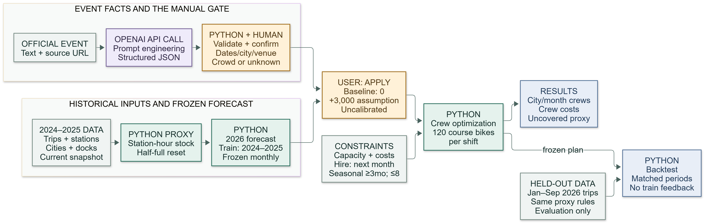

# Bluebikes Crew Planner: From Event Headlines to Crew Decisions

**DADS5250 Generative AI in Practice, Fall 2026 · Group 8**
Satoshi Nakamura · Vinay Manikandan Nagarajan · Aditi Rao

Bluebikes stations drift out of balance: some run out of bikes and others run out of empty docks, so crews with vans move bikes around. This project plans **how many rebalancing crews each Greater Boston city needs in each month of 2026**. It also shows how a public event announcement, such as the Boston Marathon, flows through to a staffing decision.

- **Python** turns 12.9 million real Bluebikes trips (2024–2025) into a monthly rebalancing workload, forecasts 2026, and finds the lowest-cost full-time and seasonal crew plan under hiring, notice and contract rules.
- **OpenAI** reads official event announcements and extracts structured facts (dates, city, venue, crowd size if stated) into a strict JSON schema.
- **A person** reviews and confirms those facts and chooses an explicit demand assumption before anything reaches the plan.
- **Held-out data** from January to September 2026 is used only to evaluate the frozen plan, never to train it.



## Course techniques used

| Technique | Where |
|---|---|
| **API calls** | OpenAI Responses API called through `requests` in [`bluebikes/events.py`](bluebikes/events.py) |
| **Prompt engineering** | Versioned extraction prompt in [`prompts/event_extraction_v1.txt`](prompts/event_extraction_v1.txt), with explicit rules for routes, unknown values and athletes vs. spectators |
| **Structured output** | Strict JSON schema ([`prompts/event_schema.json`](prompts/event_schema.json)) enforced by the API, then re-checked by a local validator before any value can be used |

## Quick start

Requires **Python 3.11+** (developed on 3.13). No OpenAI key is needed: saved real API responses are replayed by default.

**macOS / Linux**

```bash
git clone https://github.com/BitCoinJr/dads5250-bluebikes-planner.git
cd dads5250-bluebikes-planner
python3 -m venv .venv
source .venv/bin/activate
pip install -r requirements.txt
```

**Windows (PowerShell)**

```powershell
git clone https://github.com/BitCoinJr/dads5250-bluebikes-planner.git
cd dads5250-bluebikes-planner
py -m venv .venv
.\.venv\Scripts\Activate.ps1
pip install -r requirements.txt
```

Then, from the repository root:

```bash
python -m unittest discover -s tests          # run the test suite
jupyter notebook notebooks/bluebikes_submission.ipynb   # main notebook (or open it in VS Code)
```

The notebooks are committed already executed. To re-execute them from scratch, run `python scripts/build_notebook.py --execute` and `python scripts/build_demo_notebook.py --execute`. If `jupyter` is not installed, run `pip install notebook` first.

### Interactive app (optional)

```bash
python scripts/run_app.py --port 7860
```

Open http://127.0.0.1:7860 and stop the app with Ctrl+C. The app runs only on your machine and creates no public link. Try this flow:

1. Choose the **Boston Marathon** announcement and click **Load saved real response**.
2. Review the extracted facts, then click **Confirm reviewed values**.
3. Keep or change the event assumption (default: +3,000 handling actions), then click **Apply to plan**.
4. Compare crews, cost and the geographic view before and after the event.

### Live extraction with your own key (optional)

Copy `.env.example` to `.env` and set `OPENAI_API_KEY` (default model: `gpt-4.1-mini`). Then use **Extract with OpenAI** in the app. Without a key, the app reports that live extraction is unavailable; it does not substitute other data. Avoid running `python -m bluebikes.events --mode live` from the command line, because it overwrites the saved extraction results.

## Results

| Period | Plan | Crew cash cost | Uncovered rebalancing work (proxy) |
|---|---|---:|---:|
| Jan–Dec 2026 (forecast) | Keep January's 14 crews | $1,008,000 | 365,295 |
| Jan–Dec 2026 (forecast) | Optimized plan | $1,837,200 | 10,007 |
| Jan–Sep 2026 (held-out trips) | Keep January's 14 crews | $756,000 | 326,681 |
| Jan–Sep 2026 (held-out trips) | Optimized plan | $1,342,800 | 48,127 |

- **Forecast accuracy:** 9.68% WAPE on held-out January–September 2026 data.
- **Event extraction:** the model agreed with the draft reference labels on 19 of 20 fields for the four planning events, and 11 of 15 on three harder supplemental cases. The supplemental misses included confusing participants with spectators and an unsupported date.
- **Marathon scenario:** adding the event to Boston in April 2026 raises Boston from 12 to 13 full-time crews ($72,000 → $78,000 that month), with the hire decided in March.

## Key assumptions and limitations

- **Workload is a proxy.** Each station resets to half full daily, and the bikes moved to keep stations within capacity count as rebalancing work. This is not observed Bluebikes rebalancing or lost trips.
- **One crew** (driver plus van) handles 120 bikes per shift, 6 shifts per week. Full-time crews cost $6,000/month and seasonal crews $7,800/month. Hiring takes effect the following month.
- **The event demand increment is an assumption, not an estimate.** OpenAI extracts facts only; it does not predict demand. The +3,000 default is roughly one crew-month of capacity (about 3,086 in April), so the "+1 crew" Marathon result follows largely from that choice. The app lets you change it.
- **City assignment for multi-city events:** the Marathon is assigned to Boston, its finish. The route also passes through Brookline and Newton, which are not allocated any event demand.
- **Retrospective scenario:** event pages were retrieved in October 2026, so the event scenario is a what-if illustration, not a real-time forecast test.
- **Reference labels** for the extraction evaluation were drafted with AI assistance and reviewed by a team member. They are not an independent gold standard.

Full detail: [planner assumptions](docs/planner_assumptions.md), [scenario assumptions](docs/scenario_assumptions.md), [architecture](docs/architecture.md), and [event sources](docs/event_sources.md).

## Repository layout

```
bluebikes/      core package: data, inventory proxy, forecast, planner, event extraction, app
notebooks/      bluebikes_submission.ipynb (full analysis), bluebikes_demo.ipynb (short demo view)
prompts/        versioned extraction prompt and JSON schema
fixtures/       event announcement excerpts with source URLs
data/           processed monthly aggregates and source metadata (raw trip files not committed)
results/        generated tables, figures and saved API responses
scripts/        data acquisition, analysis, notebook builders, app launcher
tests/          unit tests
docs/           assumptions, architecture, demo script, review records, development log
```

To rebuild the processed data from the official Bluebikes trip archives (this downloads several GB): `python scripts/acquire_data.py --workers 4`, then `python scripts/run_analysis.py`.

## Data sources

- [Bluebikes System Data](https://bluebikes.com/system-data) and the [official trip-data bucket](https://s3.amazonaws.com/hubway-data/index.html). File names, sizes and hashes are in `data/metadata/`.
- Event announcements from the organizers' official pages, listed with retrieval dates in [docs/event_sources.md](docs/event_sources.md).

## Team contributions

| Member | Contributions |
|---|---|
| Satoshi Nakamura | Project lead; data pipeline, forecasting, crew optimization, OpenAI extraction, Gradio app and notebooks (AI-assisted development, see below); human adjudication of event cases |
| Vinay Manikandan Nagarajan | Independent review of the prototype (AI-assisted, using Claude): set up a clean environment from the repository and ran the app end to end; verified the Marathon scenario (Boston April 12 → 13 crews, $72,000 → $78,000) and hand-checked the crew-capacity arithmetic behind it; identified review issues (README readability, mixed-language UI labels, notebook failing hard on test errors, the event assumption being about one crew-month of capacity, Marathon allocation to Boston only, AI-drafted evaluation labels); prepared the README rewrite |
| Aditi Rao | _To be completed by the member_ |

## AI use

AI coding assistants (Codex/ChatGPT and Claude) were used to help write code, tests, documentation, the extraction prompt, draft reference labels and the demo script. Team members are responsible for reviewing all AI-assisted output. The runtime GenAI feature is the OpenAI structured-extraction call described above.

A detailed record of the development process, verification runs and review decisions is in [docs/DEVELOPMENT_LOG.md](docs/DEVELOPMENT_LOG.md) and [docs/DECISIONS.md](docs/DECISIONS.md).
