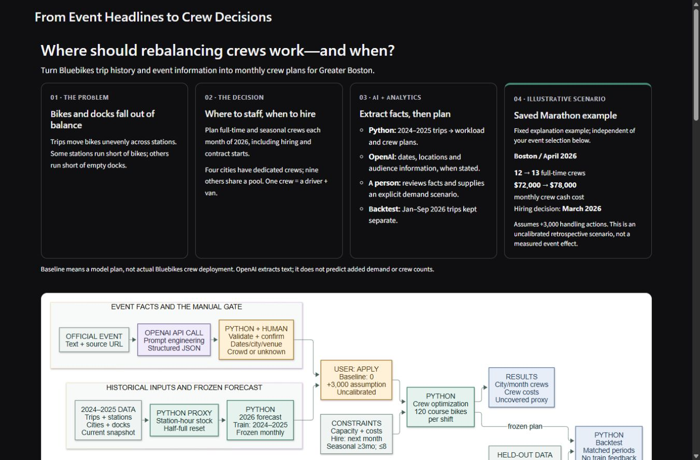

# Submission safety and Executive Summary review

Review base: `691ef6a`. This revision changes the local app's source eligibility gate and introduction only. No new model, dependency, API call or data aggregation.

## Evaluation-only exclusion

All three supplemental source IDs remain available for viewing original OpenAI outputs and separate human adjudications. Editing dates, city, venue, crowd or notes and confirming the session does not authorize their use in staffing. The UI says **Evaluation only — excluded from staffing plans** and disables Apply.

The backend retains a server-signed source ID/batch through edits, invalidation, failures and re-extraction. It also recognizes the actual matched saved source even under a different submitted ID. Apply validates the origin and rejects a supplemental source **before** invoking the planner. A UI flag is not the authorization check. A new selection of an eligible original source starts a new review flow.

The rejected participant count/date remain visible and flagged. No automatic correction, reference-label change, score change or human-review rewrite was performed.

## Executive Summary

Four short cards precede the existing Mermaid SVG: problem, staffing decision, AI/analytics roles, and a **fixed illustrative Marathon scenario**. The example comes from `results/focused_event_chain.csv` and common number/month/currency formatting. It is independent of the selected event and stays an explanation example when that event is changed or cleared.

The introduction distinguishes dedicated crews in four cities from the nine-city shared pool, OpenAI fact extraction from Python planning, and historical training from held-out evaluation. The uncalibrated retrospective increment and model-baseline meaning are stated next to the example. The Mermaid source/rendered files are unchanged.

## Verification

- **114/114 regression tests**, including five new source-identity/summary tests.
- **6/6 actual loopback HTTP checks:** all three edited/confirmed supplemental sources denied without calling the planner; original Marathon unchanged; zero increment equals baseline over all twelve months; stale source clears all outputs.
- Real Chrome: all three supplemental cases edited/confirmed with disabled Apply, including the reported city-only B.A.A. reproduction. Original Marathon still shows April FT 12→13, cash $72,000→$78,000 and March hiring; zero increment shows 12→12 and equal cash. Scenario edits and keyboard source clearing invalidate the active outputs.
- **1366×900:** all four summary cards and baseline caveat fit within the first screen (summary ends around 537px); detailed flow follows.
- **390×844:** cards stack without clipped text; the existing diagram has its own horizontal scrolling area.
- New paid API calls: **0**. Live-error and re-extraction tests use explicit mocks.
- Preserved files and both executed Notebook hashes are recorded in [machine-readable verification](verification-evaluation-gate.json). The planning method AST is unchanged. Notebook outputs are preserved, not reported as a new execution.
- [HTTP evidence](verification-evaluation-gate-http.json) was generated from the final code. Historical verification reports were not overwritten.

Reproduce automated checks:

```powershell
.\.venv\Scripts\python.exe -m unittest discover -s tests -v
.\.venv\Scripts\python.exe scripts/verify_evaluation_gate_http.py
```

The HTTP script uses dedicated local port **7878** and closes it afterwards; do not run it if that port belongs to another process. For interactive review use:

```powershell
.\.venv\Scripts\python.exe scripts/run_app.py --port 7879
```

Open http://127.0.0.1:7879 and stop with Ctrl+C. Use another free port if occupied. No public share link is created. Older review processes are not stopped; already-running older apps must be restarted by their owner to load this fix.

## Actual screenshots



[Narrow introduction](screenshots/evaluation-gate/executive-summary-narrow-top.jpg) · [Narrow illustration](screenshots/evaluation-gate/executive-summary-narrow-example.jpg) · [Exclusion reason and preserved error](screenshots/evaluation-gate/evaluation-only-reason.jpg) · [Disabled Apply after confirmation](screenshots/evaluation-gate/evaluation-only-apply-disabled.jpg) · [Original Marathon result](screenshots/evaluation-gate/marathon-regression-result.jpg)

## Remaining submission work

No known blocker remains in the two requested changes. This is not evidence of TA approval, all-member review, measured demand effects or real crew deployment. Actual timed rehearsal, recording/upload, grader repository/video access, TA confirmation, other-member contribution confirmation and Canvas submission remain incomplete. No publication, external communication, recording or submission was performed.
