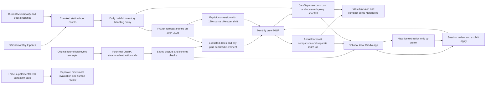

# Architecture and demo storyboard

AI-assisted implementation and review notes; human validation remains pending.

The supplemental evaluation has no path to demand or staffing. Its two positive crowd excerpts concern the same HOCR event, and its participant-only case exposes crowd/date grounding failures. Preserve 11/15 provisional agreement separately from the original four-call 19/20 result. Crowd qualifiers and unscored ambiguity text require review; schema validity does not establish semantic truth. All human review remains pending.

Recorded mode validates saved request/source/schema and output hashes, then replays real outputs with **zero new API calls**. Fixture mode is a separately labelled agent-authored contract test; it is not live execution evidence.

The optional Gradio app uses the same planning and extraction modules. Its initial state displays saved real evidence and results. **実APIで抽出 / Extract with OpenAI** makes a distinct new call into session memory; it does not replace the four-call or supplemental frozen evidence. Source, reviewed event and assumption edits invalidate an applied scenario. Review editable fields and notes, **Confirm reviewed values (this session only)**, then explicitly **Apply to plan**. This neither writes human judgments into the frozen evaluation files nor establishes reviewed gold labels. The original 19/20 and supplemental 11/15 scores and exposed failures remain separate and visible.

`create_app(root=None)` builds the app; `launch_local(root=None, port=7860, inline=False, prevent_thread_lock=False)` binds it to **127.0.0.1**, with `share=False` and analytics disabled. `scripts/run_app.py --port 7860` and the Notebook launcher use this same application. Both Notebooks default to `LAUNCH_LOCAL_APP = False`, so ordinary execution starts no server. Opt-in Notebook use calls `launch_local(ROOT, port=7860, inline=True, prevent_thread_lock=True)` and stops with `app.close()`; the CLI stops with Ctrl+C. Use port 7861 if 7860 is occupied. Integration evidence is recorded separately in [verification-gradio.json](verification-gradio.json).

The focused demo follows the saved Marathon input: **20 April 2026, Boston, assumed +3,000 handling actions, April forecast 36,721.19 to 39,721.19, FT 12 to 13, April crew cash cost $72,000 to $78,000**. Source URL and ambiguities remain visible. The increment is uncalibrated and retrospective; it does not demonstrate forecast improvement. No 2026 actual enters forecasting or coefficient selection.

In the app, a hiring decision belongs to the preceding decision month and changes active crews the following month. Display that lead explicitly; applying a new event does not make a crew immediately available. The same retrospective increment, fixed 120 course bikes/shift, counting-unit conversion and same-period cost/service limits apply to both the UI and Notebook.

The unit comparison fixes **120 bikes/shift**. Pickup plus delivery is two handling actions. Factor two converts those to one course-bike unit before replanning and converts shortage back to handling actions. The assumed penalty per handling action stays fixed. Pairing is conditional: unbalanced city/depot handling cannot automatically be halved; inspect the [synthetic walkthrough](handling_unit_walkthrough.md). This new optimization can change crew/cost recommendations; the old frozen-plan capacity sensitivity cannot. See [scenario assumptions](scenario_assumptions.md) and the [unit comparison](../results/unit_interpretation_comparison.csv).

Figures, period tables and the script share saved computation results. January-December crew cash cost is matched to annual forecast-proxy shortage; January-September crew cash cost is matched to nine-month observed-proxy shortage. Mandatory 2027 seasonal obligations are separate. The shared other-city pool is an explicit city-rule exception, not proof of feasible routes.

Use the compact [demo Notebook](../notebooks/bluebikes_demo.ipynb) for the walkthrough and the [submission Notebook](../notebooks/bluebikes_submission.ipynb) for the full audit. Inspect both artifacts' generated cells before recording; a link is not execution evidence.

Gradio recording storyboard: problem/evidence (0:00-0:25), source/actual extraction and review (0:25-1:00), explicit Apply/crew change/prior hiring (1:00-1:55), participant/date failure and correction (1:55-2:35), units/architecture/handoff (2:35-3:00). [DEMO_SCRIPT.md](DEMO_SCRIPT.md) is regenerated from the same saved numeric results. Rehearsal, video recording/upload, TA confirmation, all-member review and manual Canvas submission remain incomplete.
