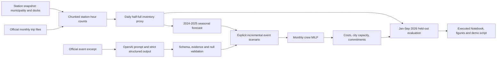

# Architecture and demo storyboard

AI-assisted initial design; human review pending.

Fixture mode replaces only the external API call with agent-authored draft records awaiting human review and is visibly labelled throughout. It is not LLM execution evidence. Default event uplift is zero; an assumed incremental stress scenario connects extracted dates and cities to demand and the crew plan.

Storyboard: problem + demand chart (0:00), real event text + JSON (0:30), crew table change (1:05), backtest + demand sensitivity (1:45), architecture + constraints (2:25). `DEMO_SCRIPT.md` is generated from the same summary as the Notebook figures. Record a screen walkthrough, rehearse to three minutes, upload an accessible link, test teaching-team access, and add the URL to the Notebook. No recording or upload is automated here.
